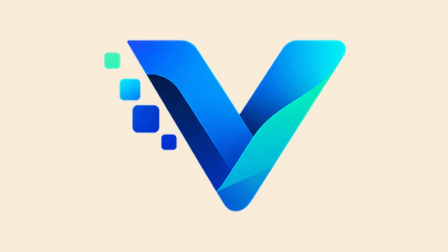
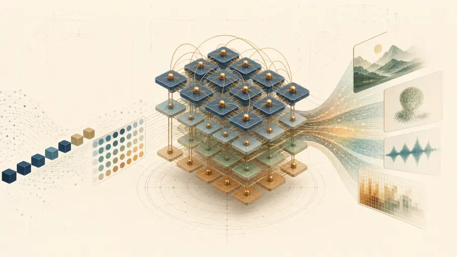
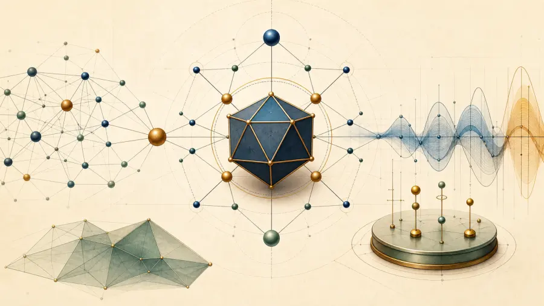
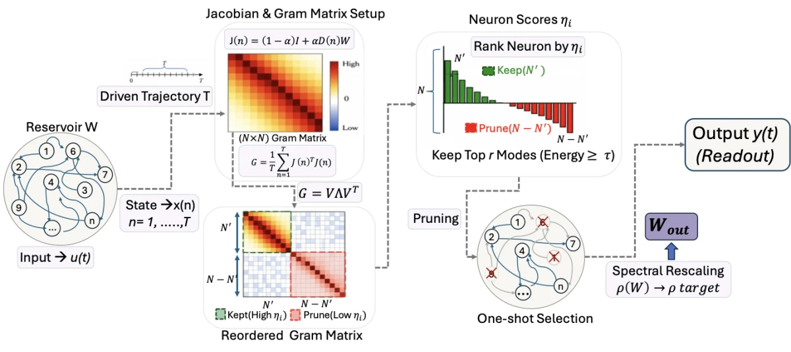
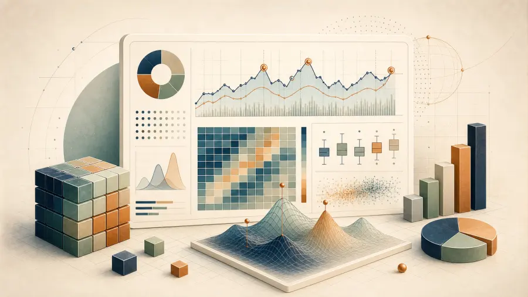
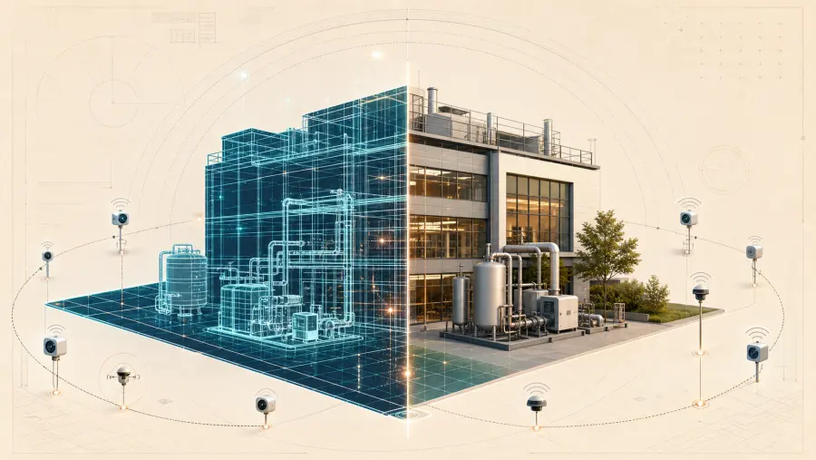

  <a href="https://github.com/Laudarisd/Laudarisd/blob/main/README.md">English</a> &nbsp;|&nbsp; <strong>한국어</strong>

  

<h1 align="center">Sudip Laudari</h1>

<i>Applied Mathematician / Data Scientist / AI & ML Researcher</i>

  
  
  

  
  
  
  

---

  계산 모델링(Computational Modelling), 컴퓨터 비전(Computer Vision), 공간정보 시스템(Geospatial Systems),
  시계열 모델링(Time-Series Modelling), 지능형 인프라를 다루는 응용수학 및 AI/ML 연구자입니다.

## 연구 노트 (Field Notes)

연구 노트북 안에서만 돌아가는 것이 아니라, 실제 환경에서도 잘 동작하는 응용수학 및 AI 시스템을 만듭니다.
제 작업은 수학적 모델링(Mathematical Modelling), 깊이 있는 연구, 제품 엔지니어링(Product Engineering),
그리고 배포 가능한 인프라(Deployable Infrastructure)가 만나는 지점에 있습니다.

현재 집중하고 있는 분야:

- 응용수학(Applied Mathematics), 계산 모델링(Computational Modelling), 수치 알고리즘(Numerical Algorithms)
- 생성형 AI(Generative AI), RAG 시스템, AI Agent 워크플로우
- 컴퓨터 비전(Computer Vision), OCR, 멀티모달(Multimodal) 애플리케이션
- 시계열 모델링(Time-Series Modelling)과 이상 탐지(Anomaly Detection)
- GIS, 원격탐사(Remote Sensing), 공간정보 시스템(Geospatial Systems)
- ML 파이프라인, 백엔드 서비스, 프로덕션 배포(Production Deployment)

## 작업 도구 (Working Desk)

**수학적 기반 (Mathematical Foundations)**

**AI 및 응용 모델링 (AI and Applied Modelling)**

**프레임워크 및 인프라 (Frameworks and Infrastructure)**

**데이터, 백엔드, 공간 시스템 (Data, Backend, and Spatial Systems)**

## 주요 포트폴리오 (Featured Portfolio)

로컬 AI 도구(Local AI Tooling), 생성형 AI(Generative AI), AI Agent, 컴퓨터 비전(Computer Vision), 연구(Research),
Reservoir Computing, 데이터 사이언스(Data Science), 디지털 트윈(Digital Twin)까지,
공개 작업을 여덟 개의 저장소로 정리했습니다.

<table>
  <tr>
    <td width="25%" valign="top">
      
       <strong>Vectra</strong> 
      프라이버시 중심의 로컬 AI 코딩(Local AI Coding), AI Agent 도구, 모델 탐색(Model Discovery).
    </td>
    <td width="25%" valign="top">
      
       <strong>Generative AI</strong> 
      LLM, Transformer, RAG, 멀티모달(Multimodal) 시스템, 파인튜닝(Fine-tuning).
    </td>
    <td width="25%" valign="top">
      
       <strong>Agent Collection</strong> 
      Job, Task, 자동화(Automation), 도구를 활용하는(Tool-using) AI Agent 워크플로우.
    </td>
    <td width="25%" valign="top">
      
       <strong>Computer Vision &amp; ML</strong> 
      객체 탐지(Detection), OCR, 어노테이션(Annotation), Vision Transformer, 배포(Deployment), MLOps.
    </td>
  </tr>
  <tr>
    <td width="25%" valign="top">
      
       <strong>Research</strong> 
      중심성(Centrality), 데이터 증강(Augmentation), 그래프 학습(Graph Learning), PINN, 재현 가능한 실험.
    </td>
    <td width="25%" valign="top">
      
       <strong>DMP &amp; ESN</strong> 
      동역학 학습(Dynamical Learning), Reservoir Pruning, 예측(Forecasting), 적응 제어(Adaptive Control).
    </td>
    <td width="25%" valign="top">
      
       <strong>Data Science</strong> 
      통계(Statistics), 예측(Forecasting), 이상 탐지(Anomaly Detection), 실무 분석(Analytics).
    </td>
    <td width="25%" valign="top">
      
       <strong>Digital Twin</strong> 
      물리 시스템 시뮬레이션(Simulation), 3D 복원(Reconstruction), 공간 지능(Spatial Intelligence).
    </td>
  </tr>
</table>

  

## 연습 공간 (Practice Bench)

  
  
  

  꾸준한 문제 풀이(Problem Solving)와 시스템 사고(Systems Thinking)로 알고리즘 기본기를 다지고 있습니다.

## 연락하기 (Correspondence)

응용수학(Applied Mathematics), 계산 모델링(Computational Modelling), AI/ML, 컴퓨터 비전(Computer Vision),
공간정보 시스템(Geospatial Systems), 엔지니어링 응용 분야에서의 연구 협업을 언제나 환영합니다.

수학적 방법을 실제 시스템과 연결하는 일을 하고 계시다면 편하게 연락 주세요.
